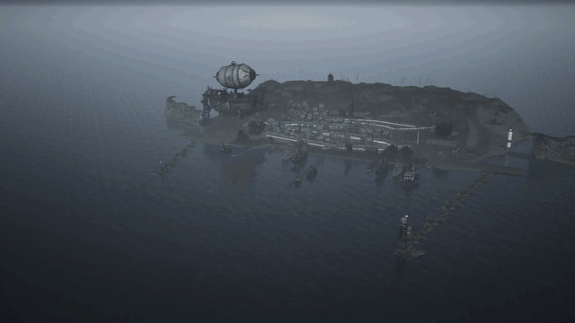
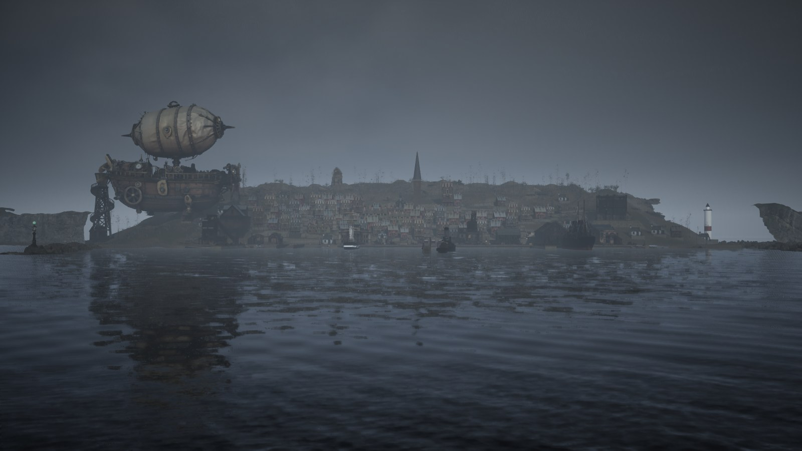
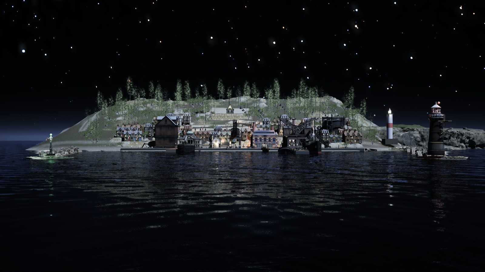
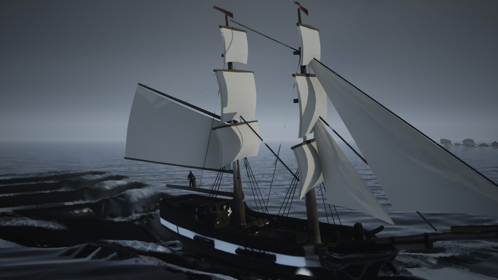
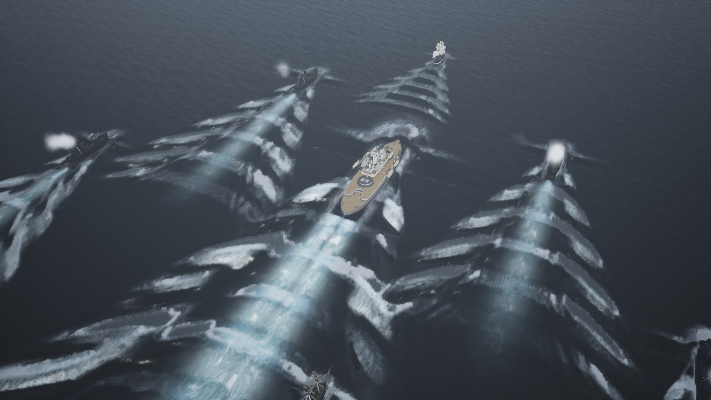
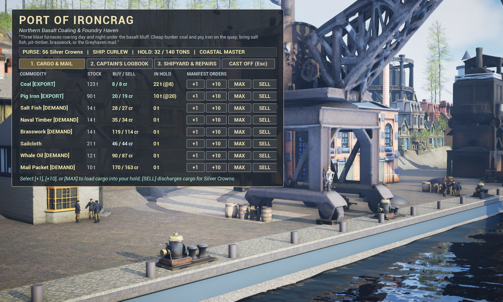
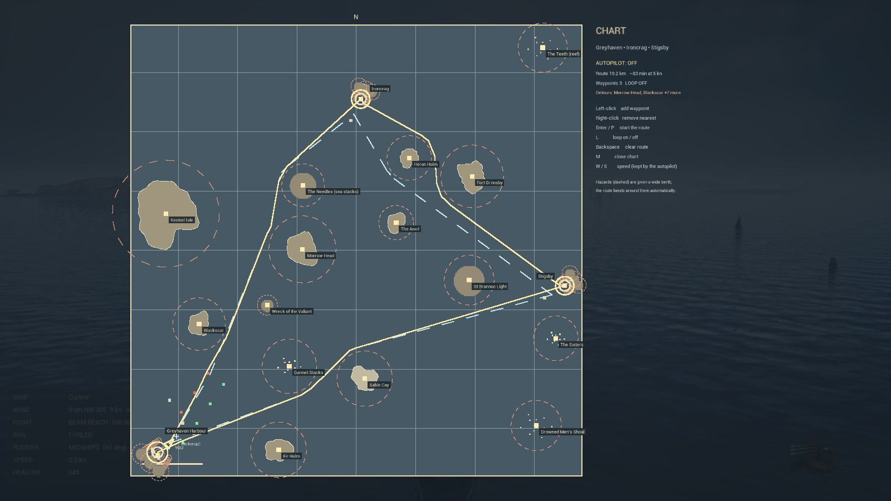

# Ironwake

[](https://charles-forsyth.github.io/ironwake/)
[](https://github.com/charles-forsyth/ironwake/actions/workflows/ci.yml)
[](https://www.unrealengine.com/)
[](LICENSE)

A steampunk naval sailing game in **Unreal Engine 5.8**. Take a turret ironclad, a rigged brig or a paddle
steamer between three working harbours, trade cargo with the harbourmaster, and sail a sea that behaves like
water: crest height by sea state, wakes from a solved Kelvin wave pattern, ships that heel, pitch and run aground.
Peaceful sailing comes first; combat exists in the code but is parked.

> **Try it in your browser:** [charles-forsyth.github.io/ironwake](https://charles-forsyth.github.io/ironwake/).
> Rotate all 18 ships, airships and waterfront buildings in 3D, mix the sea audio, drag before/after sliders,
> and drive the live wake lab on the real wake tables.

<p align="center">
  <a href="https://charles-forsyth.github.io/ironwake/">
    
  </a>
</p>

## What's in the game

| | |
|---|---|
| **Three ports** | Greyhaven (capital), Ironcrag (coal and foundry), Stigsby (fish and timber). Each harbour is data in [`Content/IronwakeData/world_ports.json`](Content/IronwakeData/world_ports.json): breakwaters, quays, berths, prices and stock. |
| **Trade and logbook** | Make fast under 2.5 knots (`Enter`) to buy and sell eight goods for Silver Crowns; record each call in the captain's logbook (`O`). |
| **A living sea** | 30 NPC ships over four ports with a harbour-mouth channel lock and quay reservations. Soak result: 0 collisions, 0 stuck, 0 groundings across three 50-minute seeds. |
| **Four ships to command** | Turret ironclad, steam frigate, cutter, and the 42 m brig *Curlew* with 17 moving rig parts (yards brace, sails reef and furl). |
| **Water** | UE Water plugin ocean with Gerstner waves by sea state (calm 0.97 m to gale 8.78 m crest-to-trough), physics substepping, depth-based grounding per hull draught. |
| **Wakes** | Havelock Kelvin wave tables at three Froude numbers plus a turbulent twin-screw wash field, solved offline and blended by speed in the water material. |
| **Sky and weather** | Continuous clock, sun for latitude 50 N, real moon phase, NASA star map at night; weather drifts between clear, overcast, mist, rain and squall. |
| **Moving parts** | 120+ animated parts: rowing crews, paddle wheels, salvage crane and diving bell, airship propellers, windmill sails. |
| **Performance** | 53 fps on the medium preset and 33 fps on high, measured in back-to-back pairs on an M-series Mac. |

## Screenshots

| Greyhaven from 400 m | Ironcrag at night |
| :---: | :---: |
|  |  |
| **The brig *Curlew* on a broad reach** | **Six ships, six wakes** |
|  |  |
| **Harbourmaster market** | **Three-port sea chart** |
|  |  |

## Repository layout

| Path | What it is |
|---|---|
| `Source/IronwakeTest/` | The C++ game module: ship pawn and hydrodynamics, water FX, collision, autopilot, NPC traffic, ports, HUD, weather, sky. |
| `Content/Python/` | Editor Python that builds materials, Niagara systems, levels and imports (run inside UE). |
| `Content/Data/`, `Content/IronwakeData/` | Wake tables, port and goods data. |
| `Config/` | Engine, input and game config. |
| `pipeline/` | Asset pipeline scripts: wake solver, brig rigging, articulated part splitting, web model prep. |
| `spec/`, `SPEC.md` | The design and technical spec. Every value cites its source file and line. |
| `docs/` | The GitHub Pages showcase (models, audio, video, site). |
| `tools/` | `verify_repo.py` (CI gate), `spec_check.py` (spec citation checker), `serve_docs.js` (local preview). |

## Building

You need Unreal Engine 5.8 with the Water, Landmass and Python Script plugins (they ship with the engine).
Development was on Apple Silicon (Metal SM6).

```bash
git clone https://github.com/charles-forsyth/ironwake.git
cd ironwake
# Open IronwakeTest.uproject in Unreal Engine 5.8 and build the IronwakeTest module.
```

**Third-party art is not in this repository.** The C++, editor Python, data, spec and pipeline scripts are
all here, but cooked `.uasset` content and the licensed source meshes, scans and textures are not; several
are CC-BY works that we credit rather than redistribute. [CREDITS.md](CREDITS.md) lists every source with its
licence and link, and the `Content/Python/` and `pipeline/` scripts show how each was imported. Point the
scripts at your own copies with the `IRONWAKE_ASSETS` environment variable.

### Checks

```bash
python3 tools/verify_repo.py        # models, page references, links, privacy scan
python3 tools/spec_check.py --all   # every spec citation still matches the code
node tools/serve_docs.js            # preview the showcase at http://127.0.0.1:8765/
```

`spec_check.py` skips citations that point at build logs and per-card tooling, which stay in the private
development repo.

## Controls

| Action | Keys |
|---|---|
| Engine telegraph / sail plan | `W` `S` (one step per press) |
| Helm | hold `A` `D`; `Q` `E` rudder midships |
| Chart and waypoints | `M`, click to add, `Enter` to sail |
| Autopilot | `P` cycles off / hold course / waypoints / tour |
| Make fast and trade | `Enter` in port under 2.5 kn |
| Captain's logbook | `O` |
| Clock speed, next weather | `T`, `L` |
| Binoculars, photo mode | `Shift`, `F` |
| Help | `H` or `F1` |

## How it was built

Ironwake is a research project on how far an agent pipeline can take a complex 3D simulation. A person set
direction and quality bars. [Hermes Agent](https://github.com/NousResearch/hermes-agent) orchestrated, and a
build agent worked one Kanban card at a time. Heavy jobs (3D generation, the wake solve, mesh prep, video
encoding) ran on an HPC cluster. Every card was tested headless and silent with fixed camera shots, multi-seed
traffic soaks and paired FPS benchmarks, and a vision reviewer scored the shots against the card's target.
A build replaced the playable app only after an independent verification card passed. The card history is in
[spec/14_history.md](spec/14_history.md).

## Credits and licence

Code is under the [MIT License](LICENSE). Third-party models, scans, textures, sky data and sounds keep their
own licences (CC-BY 4.0, CC0, NASA); see [CREDITS.md](CREDITS.md). Generated assets were made with
Hunyuan3D-2 from project concept art and rigged in Blender.
